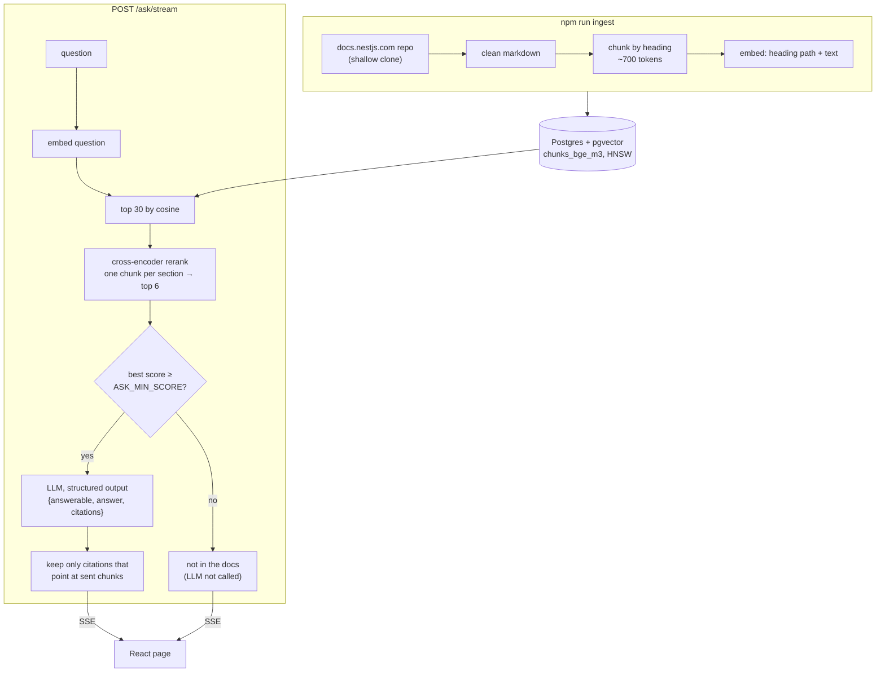

# nest-docs-rag

Ask the NestJS docs: a personal tool that answers questions about NestJS strictly from the official
documentation, with citations — or says the docs don't cover it. Runs fully locally: Ollama for
embeddings and answers, Postgres + pgvector for search. Answers can also come from a hosted model
through any OpenAI-compatible API, while search stays local.

What it does:

- **Indexes** the NestJS docs into Postgres + pgvector: chunked by heading, synced by content hash.
- **Searches** in two stages: vector top-30, then a cross-encoder reranker picks the top 6.
- **Answers** through `POST /ask` / `POST /ask/stream` (server-sent events) with numbered citations
  that the server checks, and refuses in two steps when the docs don't cover the question.
- **Measures** retrieval with `npm run eval` (hit@k, MRR) and compares embedding models, chunk sizes
  and index settings one factor at a time — results below.
- **Shows** it all on a small React page: sources first, then the answer as it is written.

No LangChain / LlamaIndex: chunking, prompts, search and the model calls are plain TypeScript over
`fetch`, because seeing each step was the point.

## Architecture



Four processes on one machine:

| Piece       | Runs as                       | Does                                                                  |
| ----------- | ----------------------------- | --------------------------------------------------------------------- |
| `apps/api`  | Node, Fastify                 | ingest / eval scripts, search, the reranker (in-process ONNX), `/ask` |
| Postgres 17 | Docker, `127.0.0.1:5433` only | one table per index (`chunks_<model>[_<suffix>]`), HNSW cosine index  |
| Ollama      | local service                 | embeddings (`bge-m3`) and, by default, the answer model (`qwen3:8b`)  |
| `apps/web`  | Vite dev server               | the ask page; proxies `/api/*` to the API                             |

The answer step can go to a hosted model instead of Ollama; embeddings, the index and the reranker
stay local either way.

Code map (`apps/api/src`):

- `providers/` — `Embedder`, `Generator`, `Reranker` interfaces (`types.ts`) and their implementations:
  `ollama/`, `openai/` (any OpenAI-compatible API), `transformers/` (the reranker); picked in
  `index.ts` from env.
- `ingest/` — `source.ts` (clone, page list and URLs from the site's sidebar), `markdown.ts`
  (cleaning), `chunker.ts`, `store.ts` (table per index, sync by hash).
- `search/search.ts` — vector search, reranking, one chunk per section.
- `ask/ask.ts` — threshold, prompt, citation check; `partial-answer.ts` reads the answer out of
  unfinished JSON for streaming.
- `eval/metrics.ts`, `scripts/eval.ts` — hit@k / MRR over `eval/questions.json`.
- `server.ts` — `/health`, `/ask`, `/ask/stream`; `config.ts` — env, validated with zod.

### Design decisions

- **A table per embedding model and setting.** Vectors of different models live in different spaces
  and pgvector fixes the dimension in the column type, so each index is its own table with its own
  HNSW index. Comparing models is comparing tables; a query vector can't meet another model's chunks.
- **Providers behind interfaces, no SDKs.** The pipeline knows `Embedder` / `Generator` / `Reranker`
  only; Ollama and the OpenAI-compatible API are a few `fetch` calls each. Switching model or provider
  is an `.env` change, and the eval runs the same pipeline for all of them.
- **Two-stage search.** Vector search finds the right page among 30 candidates but often not in the
  top 6, and its cosine score can't tell a real question from one about a neighbouring framework. A
  cross-encoder reads question and chunk together: hit@6 80% → 100%, and its score separates
  answerable from off-topic questions. It costs ~8 s per question on CPU (see Limitations).
- **Two refusals.** A score threshold before the LLM drops clearly unrelated questions for free; an
  `answerable` field in the answer schema catches the rest (same vocabulary, different framework).
  Small local models don't follow "say you don't know" reliably as a prompt instruction alone.
- **Citations by number, resolved by the server.** The model sees numbered chunks without URLs and
  returns numbers; the server keeps only numbers it actually sent and attaches the URL and text, so a
  source can't be invented.
- **Stream the same JSON.** Streaming keeps the structured output the quality was measured on; the
  server reads the growing `answer` string out of the unfinished JSON instead of switching the model
  to free text.
- **Hosted generation only.** A hosted model fixes the slow part (generation) without touching the
  index; the hosted API has no embeddings anyway, and local search is ~10 ms.

## Stack

- **API** (`apps/api`): Node 22, TypeScript, Fastify, `pg` + `pgvector`, zod for env validation
- **Web** (`apps/web`): Vite + React
- **Storage**: Postgres 17 with pgvector (Docker)
- **Models** (Ollama): `bge-m3` embeddings by default (also `nomic-embed-text`, `mxbai-embed-large`),
  `qwen3:8b` for answers
- **Hosted answers** (optional): any OpenAI-compatible Chat Completions API — measured with
  `claude-haiku-5-5` through Abacus RouteLLM
- **Reranker** (in-process, ONNX via `@huggingface/transformers`): `bge-reranker-v2-m3`, int8

Embedding and chat providers sit behind the `Embedder` / `Generator` interfaces
(`apps/api/src/providers/types.ts`) and are picked via env, so a paid API can replace Ollama without
touching the pipeline. The reranker sits behind `Reranker` the same way.

## Getting started

Prerequisites: Node 22+, Docker, [Ollama](https://ollama.com) with the models pulled:

```bash
ollama pull bge-m3 && ollama pull qwen3:8b
```

```bash
cp .env.example .env   # then set DB_USER and DB_PASSWORD; empty values use the defaults
npm install
npm run db:up        # Postgres + pgvector on localhost:5433
npm run smoke        # embed + rank two passages, then a JSON answer from the chat model
npm run ingest       # clone the NestJS docs, chunk, embed into pgvector (a few minutes the first time)
npm run dev:api      # http://127.0.0.1:3000/health, POST /ask, POST /ask/stream
npm run dev:web      # http://localhost:5173 — the ask page (proxies /api/* to the API)
```

## Indexing

`npm run ingest` turns the docs into searchable chunks:

1. **Source** — a shallow clone of [nestjs/docs.nestjs.com](https://github.com/nestjs/docs.nestjs.com)
   (MIT) in `data/raw/` (git-ignored). The pages and their URLs come from the site's own sidebar and
   route aliases, so a citation links to the live page, anchor included.
2. **Cleaning** — site-specific markup is reduced to plain markdown: the JavaScript twin of every
   code sample (`@@switch`) is dropped, `@@filename(...)` becomes a comment, callout and HTML tags go,
   table padding is collapsed.
3. **Chunking** — one chunk per heading section, up to ~700 tokens (estimated as chars / 4). Longer
   sections are packed from whole blocks with ~80 tokens of overlap; code blocks are not cut unless a
   single block is over the limit (then on line boundaries, re-fenced), long tables are split by rows
   with the header repeated. Tiny sections are merged into a neighbour instead of becoming a vector of
   almost nothing.
4. **Embedding** — the heading path (`Guards > Binding guards`) is prepended to the text, so a chunk
   carries the topic of its page even when its own text never names it.
5. **Storage** — one table per embedding model (`chunks_bge_m3`, …) with an HNSW cosine index. A run is
   a sync, keyed by a hash of the embedded text: only new or changed chunks are embedded, removed ones
   are deleted.

```bash
npm run ingest -- --dry-run                     # chunk stats and samples, no embedding, no DB
npm run ingest -- --offline                     # skip the git fetch
EMBED_MODEL=nomic-embed-text npm run ingest     # a second index to compare models
npm run ingest -- --suffix c400 --max-tokens 400   # a separate index for a chunk-size experiment
EMBED_HEADINGS=false npm run ingest                # chunks embedded without the heading chain
```

## Asking

```bash
curl -s http://127.0.0.1:3000/ask -H 'content-type: application/json' \
  -d '{"question": "How do I apply a guard to every route in the application?"}'
```

```jsonc
{
  "answered": true,
  "answer": "… you can use the `useGlobalGuards()` method … `{ provide: APP_GUARD, useClass: RolesGuard }` [1].",
  "citations": [
    {
      "n": 1,
      "url": "https://docs.nestjs.com/guards#binding-guards",
      "title": "Guards › Binding guards",
      "content": "…",
      "score": 0.97,
    },
  ],
  "retrieval": {
    "table": "chunks_bge_m3",
    "reranked": true,
    "topScore": 0.97,
    "minScore": 0.1,
    "sources": [/* all 6, as the model saw them */],
  },
  "generator": { "id": "ollama:qwen3:8b", "inputTokens": 2906, "outputTokens": 124 },
  "timingsMs": { "search": 11063, "generate": 19018, "total": 30081 },
}
```

The pipeline (`apps/api/src/ask/ask.ts`):

1. **Search** — embed the question, top 6 chunks as above (reranked, one per section).
2. **Threshold** — if the best score is below `ASK_MIN_SCORE`, the answer is "not in the docs" and the
   LLM is not called (`reason: "below_threshold"`). Defaults come from the eval: 0.1 on the reranker's
   score, 0.5 on bge-m3 cosine when reranking is off.
3. **Answer** — the chunks go into the prompt numbered `[1]…[6]`, with their heading path but no URL,
   and the model answers through structured output: `{answerable, answer, citations}`. The threshold
   only stops clearly unrelated questions; one about a neighbouring framework (Angular routing) shares
   the docs' vocabulary and passes it, so `answerable: false` is the second refusal
   (`reason: "model_declined"`).
4. **Citations** — the server keeps only numbers that point at a chunk it actually sent (in the list
   and in the `[n]` markers of the text) and attaches that chunk's URL and text itself, so a source
   can't be made up. An answer left with no valid citation is refused (`reason: "no_citations"`).

The refusal text follows the language of the question (Russian or English); the answer itself is
written in the language of the question too, while the docs are English.

All 15 eval questions through `/ask` (`qwen3:8b`, M1 Pro): the 10 answerable and 2 tricky ones are
answered, 11 of the 12 citing the expected page; borscht and Django stop at the threshold, Angular is
declined by the model. It is slow: 8–20 s of reranking plus 8–35 s of generation, the longer the
answer the longer the wait — hence streaming.

### Streaming

`POST /ask/stream` takes the same body and answers with server-sent events, so a page can show
something before the whole answer is ready:

```bash
curl -sN http://127.0.0.1:3000/ask/stream -H 'content-type: application/json' \
  -d '{"question": "How do I validate a request body with pipes?"}'
```

```text
: searching

event: retrieval
data: {"retrieval":{"table":"chunks_bge_m3","reranked":true,"topScore":0.98,…,"sources":[…]},"timingsMs":{"search":13470}}

event: delta
data: {"text":"To validate"}

… more deltas …

event: done
data: {"answered":true,"answer":"…","citations":[…],…}
```

- `retrieval` — right after search, before the model starts: the sources can be listed already.
- `delta` — pieces of the answer text. The model still answers through the same structured output
  (JSON), so the prompt and the eval results stay as measured; the server reads `answerable` and the
  growing `answer` string out of the unfinished JSON (`ask/partial-answer.ts`). Nothing is sent while
  `answerable` is unknown or false, so a refusal doesn't flash a half-written answer.
- `done` — exactly the `POST /ask` body. Its `answer` is the validated one (citation numbers that point
  at no source removed), so a client replaces the streamed text with it.
- `error` — the stream failed after it started (status is already 200 by then).

It is a POST, so read it with `fetch` and a stream reader, not `EventSource` (GET only). Closing the
connection aborts the request to Ollama, so an abandoned question stops using the CPU.

Measured on M1 Pro (`qwen3:8b`, warm): sources at ~10–13 s, first words at ~25 s, last at ~34 s — the
same total as before, but with something on screen. The gap between sources and first words is
prompt processing: Ollama reads ~230 tokens/s, and six chunks are ~1.5–3k tokens. Streaming can't
hide that; fewer or shorter chunks in the prompt can.

`CHAT_NUM_CTX` (default 8192, Ollama only) sets the chat model's context window explicitly: Ollama silently drops
the start of a prompt that does not fit, and six chunks come to ~1.5–4k tokens.

### Hosted model

The answer step can go to any OpenAI-compatible Chat Completions API instead of Ollama; embeddings,
search and reranking stay local, so the index is the same:

```bash
CHAT_PROVIDER=openai
OPENAI_BASE_URL=https://routellm.abacus.ai/v1   # default: https://api.openai.com/v1
OPENAI_API_KEY=…                                # .env only
CHAT_MODEL=claude-haiku-5-5                     # the API's model name
```

The prompt and the answer schema are the same; the schema goes out as strict structured output
(`response_format: json_schema`), and streaming uses the API's server-sent events
(`apps/api/src/providers/openai/`).

All 15 eval questions through `/ask`, same index and reranker:

|                              | correct | expected page cited | generation | total   | tokens in / out (15 q) |
| ---------------------------- | ------- | ------------------- | ---------- | ------- | ---------------------- |
| `qwen3:8b`, Ollama, M1 Pro   | 15 / 15 | 11 / 12             | 8–35 s     | 17–45 s | —                      |
| `claude-haiku-5-5`, RouteLLM | 15 / 15 | 12 / 12             | 1–6.5 s    | 10–16 s | 58.6k / 6.4k (~$0.01)  |

With a hosted model the answer is no longer the slow part: reranking is (~8 s of the ~12 s). Streaming
helps less too — with structured output the first piece arrives ~3 s after the request, and the rest
within a second or two.

## Web page

`apps/web` is one page over `POST /ask/stream`: a question box, then the sources as soon as search is
done, the answer text as the model writes it, and the final answer with `[n]` linked to its sources
(the uncited ones dimmed) — or the refusal with its reason. A status line says which step the wait is
in (searching / the model is reading the sources / writing) with a running timer; under the answer
are the timings, the generator and its token counts. A new question, **Stop**, or leaving the page
aborts the request, and the server stops generating.

- `src/api/sse.ts` — reads a `text/event-stream` body from `fetch`: events cut anywhere by the
  network, a Cyrillic letter split between pieces, CRLF / CR, comments, multi-line `data`.
- `src/api/ask-stream.ts` — the endpoint as typed events; a 4xx/5xx before the stream (e.g. an empty
  question) throws with the server's message.
- `src/ask/state.ts` — a reducer: `idle → searching → answering → done`, or `error` / `cancelled`
  keeping the sources and the partial text; late events after Stop are ignored.
- `src/ask/answer-text.ts` — the little Markdown the answers use (`inline code`, ``` fences, also an
  unclosed one mid-stream) and `[n]` markers, without a Markdown library.

In development Vite proxies `/api/*` to the API, so no CORS setup is needed and the stream is not
buffered. `npm test -w apps/web` runs the page's unit tests (vitest).

## Evaluation

`npm run eval` measures retrieval on a fixed question set (`apps/api/eval/questions.json`): 10
questions answered by the docs (Russian and English, with the expected page and section), 3 off-topic
ones and 2 tricky ones (an answer split across two pages, a question worded with synonyms). For each
question it embeds the query, takes the top 6 chunks and reports:

- **hit@1 / hit@3 / hit@6 and MRR** — at page level (anchor ignored) and at section level;
- **top similarity** of every question, and whether one threshold separates answerable questions
  from off-topic ones — the input for the "not in the docs" cut-off, set per model.

```bash
npm run eval                        # the configured model's index
npm run eval -- --suffix c400       # an experiment index built with the same --suffix
npm run eval -- --verbose           # also print the top chunks of every question
npm run eval -- --no-dedupe         # raw nearest neighbours, for comparison
npm run eval -- --per-page 2        # also cap chunks per page
npm run eval -- --rerank            # re-order the candidates with the cross-encoder
npm run eval -- --candidates 20     # size of the candidate pool (default 30)
npm run eval -- --report            # Markdown table of all saved runs
```

The search keeps at most one chunk per section (URL with anchor): it fetches the 30 nearest chunks
and drops repeats, because a long section is split into several chunks and would otherwise take
several of the k slots.

### Reranking

Vector search is a bi-encoder: the question and each chunk are embedded separately, so a chunk's
vector is fixed before the question is known. Near-topic sections of other pages (rate limiting on
sign-in in a tutorial vs the Rate limiting page) end up within noise of each other. A cross-encoder
reads the question and a chunk together and scores the pair, which is far better at ordering — but
it cannot be precomputed, so it only re-orders the 30 candidates from vector search.

Ollama has no rerank endpoint, so `bge-reranker-v2-m3` (multilingual, the reranking pair of
`bge-m3`) runs in-process with ONNX Runtime; the int8 model (~0.6 GB) is downloaded on first use
into `data/models/`. Set `RERANK_PROVIDER=none` to turn it off.

First results on `chunks_bge_m3`, 10 answerable questions:

|             | hit@1 | hit@3 | hit@6 | MRR   | section hit@6 | answerable min | off-topic max | search time |
| ----------- | ----- | ----- | ----- | ----- | ------------- | -------------- | ------------- | ----------- |
| vector only | 60%   | 70%   | 80%   | 0.658 | 70%           | 0.611          | 0.637         | ~10 ms      |
| + reranker  | 50%   | 90%   | 100%  | 0.692 | 100%          | 0.619          | 0.427         | ~8.5 s      |

Every answerable question now has its page in the top 6, and its score separates it from the
off-topic ones (cosine could not: the Django serializer question scored above two real ones). The
cost is latency: about 8.5 s per question on an M1 Pro CPU (30 pairs of up to 512 tokens through a
568M-parameter model). The two "tricky" questions (an answer split across pages) get low reranker
scores, since no single chunk answers them.

### Comparing indexes

One factor at a time from the default index (`bge-m3`, chunks of up to 700 tokens, heading chain
prepended); all new indexes built from the same docs commit. Page level, 10 answerable questions:

| Index                                     | hit@1 | hit@3 | hit@6 | MRR   | section hit@3 | tricky hit@6 |
| ----------------------------------------- | ----- | ----- | ----- | ----- | ------------- | ------------ |
| `bge-m3` 700 (default)                    | 60%   | 70%   | 80%   | 0.658 | 40%           | 100%         |
| `bge-m3` 400                              | 50%   | 80%   | 90%   | 0.637 | 70%           | 100%         |
| `bge-m3` 700, no heading chain            | 70%   | 70%   | 80%   | 0.725 | 60%           | 100%         |
| `nomic-embed-text` 400                    | 50%   | 60%   | 60%   | 0.533 | 50%           | 50%          |
| `nomic-embed-text` 400, no prefixes       | 60%   | 60%   | 70%   | 0.620 | 50%           | 50%          |
| `mxbai-embed-large` 400                   | 60%   | 70%   | 70%   | 0.633 | 50%           | 50%          |
| `bge-m3` 700 + reranker                   | 50%   | 90%   | 100%  | 0.692 | 90%           | 100%         |
| `bge-m3` 400 + reranker                   | 60%   | 90%   | 100%  | 0.750 | 90%           | 100%         |
| `bge-m3` 700, no heading chain + reranker | 70%   | 80%   | 90%   | 0.758 | 80%           | 50%          |

(`mxbai-embed-large` has a 512-token context, so the model comparison uses 400-token chunks.)

- **Model:** `nomic-embed-text` and `mxbai-embed-large` are English-only and miss most Russian
  questions; on English ones they match `bge-m3`. Being multilingual matters more than the model.
- **Chunk size:** 400 widens recall (hit@6 90%) but puts the right page first less often; with the
  reranker on top it is the best setup overall.
- **Heading chain:** without it, vector search alone ranks better, but the reranker loses two
  questions — it needs the "which page is this from" context.
- **Prefixes** (`nomic-embed-text`): a difference of one or two questions — noise at this set size.

The app stays on the default index for now: 15 questions are too few to tell a 0.05 MRR gap from
noise, so switching waits for a larger question set. `EMBED_HEADINGS=false` builds and searches an
index without the heading chain (table `…_noheadings`; the reranker reads the same text).

Each run is saved to `reports/eval/<table>[__<variant>].json` (git-ignored); the variant names a
non-default search setting (`raw`, `p2`, `rr`, `n20`). `npm run eval -- --report` prints all saved
runs as one Markdown table.

`npm test`, `npm run typecheck`, `npm run format:check` — the usual checks.

## Limitations

- **Latency.** Reranking is ~8 s per question on an M1 Pro CPU (30 pairs, one at a time); with the
  local model a full answer takes 17–45 s, with a hosted one 10–16 s. Streaming shows the sources
  first, but the wait is real.
- **A small question set.** 15 questions are enough to see large effects (the reranker, multilingual
  models), not to tell a 0.05 MRR gap from noise — so the best measured setup (400-token chunks +
  reranker) is not the default yet.
- **Answers spread across pages** get low reranker scores, since no single chunk answers them; they
  pass the threshold today, but with little margin.
- **Retrieval is measured, answers are checked by hand.** The eval scores search; `/ask` was run on
  the same 15 questions and read, not scored automatically.
- **Answer details.** The model sometimes copies relative links from the docs (`/fundamentals/…`),
  and long answers in Russian don't always place `[n]` markers in the text (the citation list still
  comes back).
- **A local, single-user tool.** No auth, no rate limits, no deployment; the database listens on
  loopback only.

Next, roughly in order: a larger question set (~25), then switching to 400-token chunks; a smaller
prompt (fewer or trimmed chunks) for a faster first word; hybrid search (vectors + Postgres full-text);
a cache of reranker scores in the eval.

## License

[MIT](LICENSE). The NestJS documentation that the index is built from is MIT-licensed as well; it is
cloned at ingest time and not stored in this repository.
